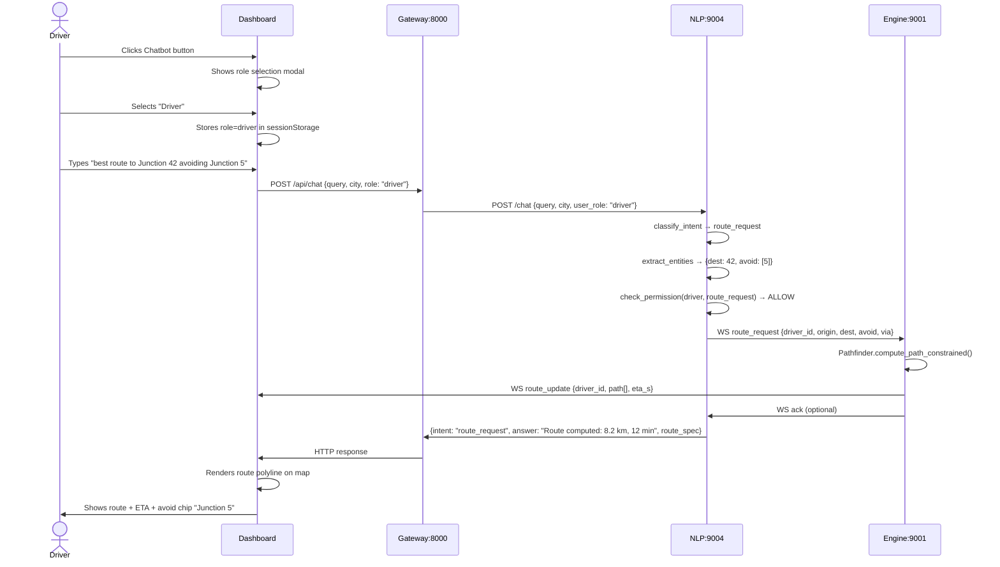
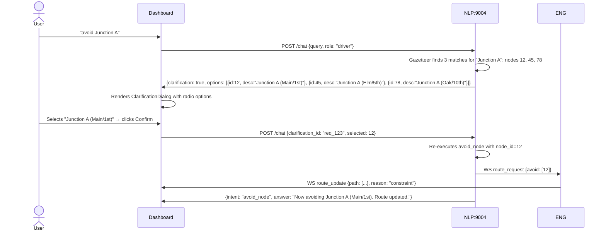
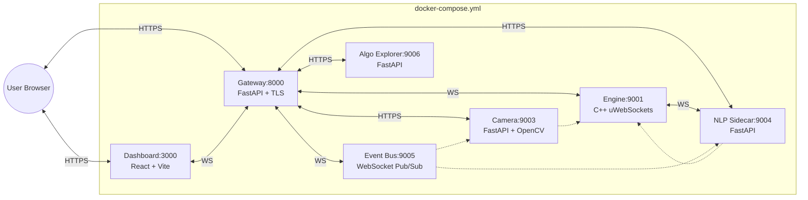

# 03_architecture.md — Component Diagram & System Architecture

**Version:** 1.0  
**Status:** Draft  
**Owner:** Senior Systems Architect  
**Last Updated:** October 2026

---

## Table of Contents
1. [High-Level Architecture](#1-high-level-architecture)
2. [Component Diagram (Mermaid)](#2-component-diagram-mermaid)
3. [Component Responsibilities](#3-component-responsibilities)
4. [Data Flow Sequences](#4-data-flow-sequences)
5. [API Contracts](#5-api-contracts)
6. [Deployment Topology](#6-deployment-topology)
7. [Integration Points](#7-integration-points)

---

## 1. High-Level Architecture

The revamp adds three new logical components to the existing NexusSim sidecar architecture:

1. **Chatbot UI** — Dashboard panel with role selection, chat history, driver/admin views
2. **NLP Intent/Entity Layer** — Extended `chat_service.py` with driver intents, constraint entities, scenario entities, guardrails
3. **Scenario Modulation Service** — New engine API `apply_scenario()` + `remove_scenario()` + composite scenario manager
4. **Driver Session Manager** — Engine-side registry of driver sessions, constraints, and reroute subscriptions

All existing components (engine, dashboard, gateway, NLP sidecar, CV, event bus, algo explorer) remain unchanged except for additive interfaces.

---

## 2. Component Diagram (Mermaid)

```mermaid
graph TB
    %% Styles
    classDef engine fill:#1e3a5f,color:#fff,stroke:#3b82f6,stroke-width:2px
    classDef dashboard fill:#0f172a,color:#fff,stroke:#6366f1,stroke-width:2px
    classDef nlp fill:#14532d,color:#fff,stroke:#22c55e,stroke-width:2px
    classDef gateway fill:#3f1d3b,color:#fff,stroke:#a855f7,stroke-width:2px
    classDef sidecar fill:#431407,color:#fff,stroke:#f97316,stroke-width:2px
    classDef data fill:#1a1a2e,color:#fff,stroke:#06b6d4,stroke-width:1px,stroke-dasharray: 5 5
    classDef new fill:#7f1d1d,color:#fff,stroke:#ef4444,stroke-width:3px

    subgraph Dashboard["📱 Dashboard (React 19 + Leaflet) :3000"]
        DB_MAP[Map.tsx<br/>Agent markers, routes, equity overlay]
        DB_DOCK[RightDock.tsx<br/>Tabs: Metrics, Vision, Chat, Algos, Carbon]
        DB_CHAT[ChatBotPanel.tsx ★<br/>Role select, chat history, driver/admin views]
        DB_CLAR[ClarificationDialog.tsx ★<br/>Ambiguity resolution]
        DB_AUDIT[AuditLogViewer.tsx ★<br/>Admin audit log table]
        DB_NLP[NLPCommandConsole.tsx<br/>Dev console - unchanged]
    end

    subgraph Gateway["🌐 API Gateway (FastAPI) :8000"]
        GW_AUTH[Auth & JWT<br/>Roles: admin, editor, viewer, driver ★]
        GW_WS[WS Proxy /ws → Engine:9001]
        GW_CHAT[REST Proxy /api/chat → NLP:9004]
        GW_INC[REST Proxy /api/incident → NLP:9004]
        GW_SIM[Simulations & Scenarios SaaS]
        GW_ALGO[Algo Registry]
        GW_ING[Real-time Ingestion]
    end

    subgraph Engine["⚙️ C++ Engine (uWebSockets) :9001"]
        ENG_SIM[Simulation Core<br/>tick(), agents, signals, metrics]
        ENG_GRAPH[Graph Loader<br/>graph.json → adjacency list]
        ENG_PATH[Pathfinder<br/>A* + stochastic + constraints ★]
        ENG_SCEN[Scenario Manager ★<br/>apply_scenario, remove, composite, expiry]
        ENG_DRV[Driver Session Mgr ★<br/>sessions, constraints, reroute subscriptions]
        ENG_INC[Incident Handler<br/>apply_incident - existing]
        ENG_WS[WS Server<br/>Broadcast + Control Messages]
        ENG_ONNX[ONNX Inference<br/>RL policies - unchanged]
    end

    subgraph NLP_Sidecar["💬 NLP Chat & Incident Sidecar :9004"]
        NLP_CHAT[Chat Service<br/>FastAPI /chat, /incident]
        NLP_INTENT[Intent Classifier ★<br/>Driver + Admin taxonomies]
        NLP_ENT[Entity Extractor ★<br/>Junction, road, severity, duration]
        NLP_GAZ[Gazetteer<br/>graph.json edge names + rapidfuzz]
        NLP_GUARD[Role Guardrails ★<br/>Intent × Role matrix]
        NLP_CLAR[Clarification Engine ★<br/>Multi-match resolution]
        NLP_AUDIT[Audit Logger ★<br/>JSONL append-only]
        NLP_WS[WS Client → Engine:9001<br/>Caches metrics, zone_metrics, signals]
    end

    subgraph Other_Sidecars["🔧 Other Sidecars"]
        CV_CAM[Virtual Camera :9003]
        EVT_BUS[Event Bus :9005]
        ALGO_EXP[Algo Explorer :9006]
    end

    subgraph Data["💾 Data Stores"]
        GRAPH[(graph.json<br/>nodes, edges, zones)]
        OD_MATRIX[(od_matrix.json<br/>demand)]
        POLICY[(policy.onnx<br/>RL weights)]
        AUDIT_LOG[(audit.log ★<br/>JSONL append-only)]
        SESSION_STORE[(Session Storage<br/>Browser - role, driver_id)]
    end

    %% Connections
    DB_MAP <-- WS --> GW_WS
    DB_DOCK <-- WS --> GW_WS
    DB_CHAT <-- HTTPS --> GW_CHAT
    DB_CHAT <-- HTTPS --> GW_INC
    DB_AUDIT <-- HTTPS --> GW_SIM
    
    GW_WS <-- WS --> ENG_WS
    GW_CHAT <-- HTTPS --> NLP_CHAT
    GW_INC <-- HTTPS --> NLP_CHAT
    
    NLP_CHAT --> NLP_INTENT
    NLP_CHAT --> NLP_ENT
    NLP_CHAT --> NLP_GUARD
    NLP_CHAT --> NLP_AUDIT
    NLP_INTENT --> NLP_CLAR
    NLP_ENT --> NLP_GAZ
    NLP_WS <-- WS --> ENG_WS
    
    ENG_WS --> ENG_SIM
    ENG_SIM --> ENG_PATH
    ENG_SIM --> ENG_SCEN
    ENG_SIM --> ENG_DRV
    ENG_SIM --> ENG_INC
    ENG_PATH --> ENG_GRAPH
    ENG_SCEN --> ENG_GRAPH
    
    ENG_GRAPH -.-> GRAPH
    ENG_SIM -.-> OD_MATRIX
    ENG_ONNX -.-> POLICY
    NLP_GAZ -.-> GRAPH
    NLP_AUDIT -.-> AUDIT_LOG
    DB_CHAT -.-> SESSION_STORE
    
    %% New component markers
    class DB_CHAT,DB_CLAR,DB_AUDIT new
    class ENG_PATH,ENG_SCEN,ENG_DRV new
    class NLP_INTENT,NLP_ENT,NLP_GUARD,NLP_CLAR,NLP_AUDIT new
    class GW_AUTH new
    class AUDIT_LOG,SESSION_STORE new
    
    class DB_MAP,DB_DOCK,DB_NLP dashboard
    class GW_AUTH,GW_WS,GW_CHAT,GW_INC,GW_SIM,GW_ALGO,GW_ING gateway
    class ENG_SIM,ENG_GRAPH,ENG_PATH,ENG_SCEN,ENG_DRV,ENG_INC,ENG_WS,ENG_ONNX engine
    class NLP_CHAT,NLP_INTENT,NLP_ENT,NLP_GAZ,NLP_GUARD,NLP_CLAR,NLP_AUDIT,NLP_WS nlp
    class CV_CAM,EVT_BUS,ALGO_EXP sidecar
    class GRAPH,OD_MATRIX,POLICY,AUDIT_LOG,SESSION_STORE data
```

---

## 3. Component Responsibilities

### 3.1 New Components (★ = New)

| Component | Location | Responsibility |
|-----------|----------|----------------|
| **ChatBotPanel.tsx** | `dashboard/src/components/` | Main chatbot UI: role selection modal, chat history, driver view (route + constraints), admin view (scenarios + metrics quick-chips) |
| **ClarificationDialog.tsx** | `dashboard/src/components/` | Modal for ambiguous entity resolution (multiple gazetteer matches) |
| **AuditLogViewer.tsx** | `dashboard/src/components/` | Admin-only table: timestamp, user, intent, raw text, parsed spec, edge deltas |
| **Pathfinder (extended)** | `engine/src/agents/Pathfinder.h` | `compute_path_constrained(origin, dest, avoid[], via[])` → path + ETA |
| **ScenarioManager** | `engine/src/agent/ScenarioManager.h` | `apply_scenario()`, `remove_scenario()`, composite multipliers, expiry timer, `scenario_changed` broadcast |
| **DriverSessionManager** | `engine/src/agent/DriverSessionManager.h` | `register_driver(driver_id, agent_id)`, `update_constraints()`, `get_subscribers(edges[])` |
| **IntentClassifier (extended)** | `ml/nlp/chat_service.py` | Driver intents (`route_request`, `avoid_node`, `via_node`, `clear_constraints`) + Admin intents (`scenario_update`, `query_efficiency`, `query_incidents`, `cancel_scenario`) |
| **EntityExtractor (extended)** | `ml/nlp/chat_service.py` / `incident_parser.py` | Junction/node IDs, road/edge IDs, severity enum, duration parsing, time windows |
| **RoleGuardrails** | `ml/nlp/chat_service.py` | `check_permission(role, intent)` → allow/deny + audit log entry |
| **ClarificationEngine** | `ml/nlp/chat_service.py` | Detect multi-match → return clarification options → re-execute on selection |
| **AuditLogger** | `ml/nlp/chat_service.py` | Append JSONL to `/var/log/nexussim/audit.log` with hash chain |

### 3.2 Existing Components (Extended)

| Component | Extension |
|-----------|-----------|
| `gateway/auth.py` | Add `driver` role to USERS; `require_role(["driver"])` dependency |
| `gateway/server.py` | No new endpoints needed; existing `/api/chat`, `/api/incident` proxy to NLP |
| `engine/src/network/WebSocketServer.h` | Dispatch new inbound: `driver_register`, `route_request`; new outbound: `route_update`, `scenario_changed` |
| `dashboard/src/hooks/useWebSocket.ts` | Handle `route_update`, `scenario_changed` message types |
| `dashboard/src/components/RightDock.tsx` | Add ChatBotPanel to Chat tab (alongside ChatPanel + IncidentReportPanel) |
| `ml/nlp/incident_parser.py` | Reused for gazetteer; extended for scenario target extraction |

---

## 4. Data Flow Sequences

### 4.1 Driver Requests Route (Happy Path)



### 4.2 Admin Issues Scenario Modulation

```mermaid
sequenceDiagram
    actor Admin
    participant DB as Dashboard
    participant GW as Gateway:8000
    participant NLP as NLP:9004
    participant ENG as Engine:9001
    participant AUDIT as Audit Log

    Admin->>DB: Types "bridge at Junction A under construction, heavy traffic for 2 hours"
    DB->>GW: POST /api/chat {query, city, role: "admin"}
    GW->>NLP: POST /chat {query, city, user_role: "admin"}
    NLP->>NLP: classify_intent → scenario_update
    NLP->>NLP: extract_entities → {target: "Junction A", operation: "reduce_capacity", severity: 0.7, duration: 7200}
    NLP->>NLP: Gazetteer resolves "Junction A" → node 12 → incident edges [42, 43, 44]
    NLP->>NLP: check_permission(admin, scenario_update) → ALLOW
    NLP->>AUDIT: Append {ts, user, role, intent, raw_text, parsed_spec, edges: [42,43,44], severity: 0.7}
    NLP->>ENG: WS apply_scenario {edges: [42,43,44], severity: 0.7, duration_s: 7200, source: "admin"}
    ENG->>ENG: ScenarioManager.apply_scenario()
    ENG->>ENG: Updates edge multipliers; starts expiry timer
    ENG->>ENG: DriverSessionManager.get_subscribers([42,43,44]) → [driver_1, driver_7, ...]
    ENG->>DB: WS scenario_changed {edges: [42,43,44], new_multiplier: 0.3, source: "admin"}
    ENG->>DB: WS route_update {driver_id: driver_1, path: [...], eta_s: 420, reason: "scenario"}
    ENG->>DB: WS route_update {driver_id: driver_7, path: [...], eta_s: 380, reason: "scenario"}
    NLP->>GW: {intent: "scenario_update", answer: "Construction applied to 3 edges at Junction A. 12 drivers rerouted."}
    GW->>DB: HTTP response
    DB->>Admin: Shows confirmation + updated metrics
    DB->>Drivers: Map updates with new routes
```

### 4.3 Ambiguity Clarification



---

## 5. API Contracts

### 5.1 Engine WebSocket Messages (Extended)

#### Inbound (Dashboard/NLP → Engine)

| Type | Payload | Purpose |
|------|---------|---------|
| `driver_register` | `{ "driver_id": "drv_abc123", "agent_id": 42 }` | Associate driver session with simulated agent |
| `route_request` | `{ "driver_id": "drv_abc123", "origin": 10, "destination": 42, "avoid": [5], "via": [20] }` | Compute constrained route |
| `driver_constraints` | `{ "driver_id": "drv_abc123", "avoid": [5, 8], "via": [20] }` | Update constraints; triggers reroute |
| `apply_scenario` | `{ "edges": [42,43], "severity": 0.7, "duration_s": 7200, "source": "admin" }` | Admin scenario mutation |
| `remove_scenario` | `{ "edges": [42,43], "source": "admin" }` | Admin scenario removal |

#### Outbound (Engine → Dashboard/NLP)

| Type | Payload | Purpose |
|------|---------|---------|
| `route_update` | `{ "driver_id": "drv_abc123", "path": [10,15,20,42], "eta_s": 420, "distance_m": 8200, "reason": "constraint|scenario|incident" }` | Driver's new route |
| `scenario_changed` | `{ "edges": [42,43], "new_multiplier": 0.3, "source": "admin|incident|expiry", "active_scenarios": [...] }` | Edge weight change notification |
| `driver_registered` | `{ "driver_id": "drv_abc123", "agent_id": 42, "status": "ok" }` | Registration confirmation |

### 5.2 NLP REST API (Extended)

#### `POST /chat` (Extended)

**Request:**
```json
{
  "query": "best route to Junction 42 avoiding Junction 5",
  "city": "chicago",
  "role": "driver",
  "driver_id": "drv_abc123",
  "clarification_id": "req_123",
  "selected_entity": 12
}
```

**Response (Success):**
```json
{
  "intent": "route_request",
  "answer": "Route computed: 8.2 km, 12 min via nodes [10,15,20,42]",
  "confidence": 0.94,
  "handler": "rule_based_regex",
  "route_spec": {
    "path": [10, 15, 20, 42],
    "eta_s": 720,
    "distance_m": 8200,
    "constraints": { "avoid": [5], "via": [] }
  }
}
```

**Response (Clarification Needed):**
```json
{
  "clarification": true,
  "clarification_id": "req_123",
  "original_intent": "avoid_node",
  "entity": "junction",
  "query": "Junction A",
  "options": [
    { "id": 12, "description": "Junction A (Main St / 1st Ave)", "lat": 41.88, "lon": -87.63 },
    { "id": 45, "description": "Junction A (Elm St / 5th Ave)", "lat": 41.89, "lon": -87.62 },
    { "id": 78, "description": "Junction A (Oak St / 10th Ave)", "lat": 41.90, "lon": -87.61 }
  ]
}
```

**Response (Denied - Guardrail):**
```json
{
  "error": "forbidden",
  "message": "Driver role cannot execute scenario_update intent",
  "intent": "scenario_update",
  "required_role": "admin"
}
```

#### `POST /incident` (Unchanged - reused for admin scenario parsing)
- Input: `{ "text": "...", "city": "chicago" }`
- Output: `{ "status": "applied", "incident_spec": { "edges": [...], "severity": 0.7, "duration_s": 7200 } }`

### 5.3 Gateway Auth (Extended)

**Login Request:**
```bash
POST /api/auth/login
username=driver1&password=driver1
```

**Response:**
```json
{
  "access_token": "eyJhbGciOiJIUzI1NiIs...",
  "token_type": "bearer",
  "user": { "username": "driver1", "workspaces": ["ws_default"], "role": "driver" },
  "workspaces": [...]
}
```

---

## 6. Deployment Topology



**Ports Summary:**
| Service | Internal | External (Gateway) | Protocol |
|---------|----------|-------------------|----------|
| Engine | 9001 | 8000/ws | WebSocket |
| Dashboard | 3000 | 3000 | HTTPS |
| NLP Chat | 9004 | 8000/api/chat | HTTPS |
| Virtual Camera | 9003 | 8000/api/camera | HTTPS |
| Event Bus | 9005 | 8000/ws/events | WebSocket |
| Algo Explorer | 9006 | 8000/api/algo | HTTPS |

---

## 7. Integration Points

| Integration | From | To | Mechanism | Contract |
|-------------|------|----|-----------|----------|
| Chatbot → NLP | Dashboard | NLP Sidecar | HTTPS POST /api/chat | `ChatRequest` / `ChatResponse` |
| NLP → Engine (route) | NLP Sidecar | Engine | WebSocket `route_request` | `RouteRequest` / `RouteUpdate` |
| NLP → Engine (scenario) | NLP Sidecar | Engine | WebSocket `apply_scenario` | `ScenarioSpec` / `ScenarioChanged` |
| Engine → Dashboard (route) | Engine | Dashboard | WebSocket `route_update` | `RouteUpdate` |
| Engine → Dashboard (scenario) | Engine | Dashboard | WebSocket `scenario_changed` | `ScenarioChanged` |
| Engine → NLP (metrics cache) | Engine | NLP Sidecar | WebSocket broadcast | `StateFrame` (existing) |
| Dashboard → Auth | Dashboard | Gateway | HTTPS POST /api/auth/login | JWT token |
| Audit Log → Disk | NLP Sidecar | Filesystem | Append-only write | JSONL + hash chain |

---

## 8. Error Handling & Fallbacks

| Failure Point | Detection | Fallback Behavior |
|---------------|-----------|-------------------|
| NLP sidecar down | Gateway health check / request timeout | Dashboard shows "NLP offline" banner; ChatPanel offline mode (existing) |
| Engine WS disconnect | `useWebSocket` reconnect logic | Auto-reconnect with exponential backoff; driver session preserved in engine |
| Gazetteer multi-match | NLP returns `clarification: true` | Dashboard renders ClarificationDialog; user resolves |
| Route computation fails | Engine returns error in `route_update` | NLP returns "Unable to compute route: no path found with constraints" |
| Scenario conflicts | ScenarioManager detects overlapping | Composite multipliers applied; audit log records all |
| Driver session lost | Engine `driver_register` not found | Dashboard prompts re-register; constraints re-sent |

---

## 9. Configuration

| Config | Location | Purpose |
|--------|----------|---------|
| `nlp/intents.yaml` | `ml/nlp/` | Intent patterns, allowed roles, entity schemas (new) |
| `nlp/gazetteer.yaml` | `ml/nlp/` | Gazetteer rebuild triggers, fuzzy threshold (new) |
| `engine/scenario_limits.yaml` | `engine/config/` | Max scenarios per edge, severity bounds, expiry defaults (new) |
| `gateway/auth.py` | `gateway/` | Add driver user credentials |
| `dashboard/src/config/chatbot.ts` | `dashboard/src/config/` | Chatbot feature flags, role options, quick-chips (new) |