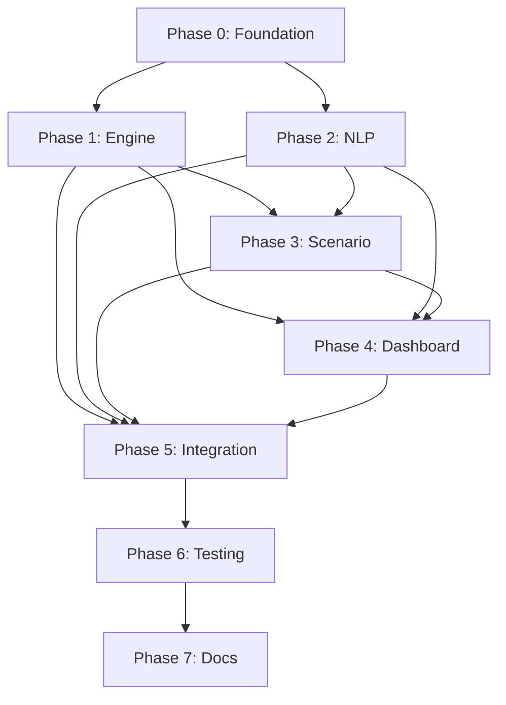

# 09_implementation_roadmap.md — Phased Implementation Plan

**Version:** 1.0  
**Status:** Draft  
**Owner:** Senior Systems Architect  
**Last Updated:** October 2026

---

## Table of Contents
1. [Roadmap Overview](#1-roadmap-overview)
2. [Phase 0: Foundation & Setup (Week 1)](#2-phase-0-foundation--setup-week-1)
3. [Phase 1: Core Engine Extensions (Weeks 2-3)](#3-phase-1-core-engine-extensions-weeks-2-3)
4. [Phase 2: NLP Intent & Entity Layer (Weeks 3-4)](#4-phase-2-nlp-intent--entity-layer-weeks-3-4)
5. [Phase 3: Scenario Modulation Service (Week 4)](#5-phase-3-scenario-modulation-service-week-4)
6. [Phase 4: Dashboard Chatbot UI (Weeks 5-6)](#6-phase-4-dashboard-chatbot-ui-weeks-5-6)
7. [Phase 5: Integration & Guardrails (Week 6)](#7-phase-5-integration--guardrails-week-6)
8. [Phase 6: Testing & Polish (Week 7)](#8-phase-6-testing--polish-week-7)
9. [Phase 7: Documentation & Handoff (Week 8)](#9-phase-7-documentation--handoff-week-8)
10. [Dependency Graph](#10-dependency-graph)
11. [Effort Estimates](#11-effort-estimates)
12. [Risks & Mitigations](#12-risks--mitigations)
13. [Milestone Definitions](#13-milestone-definitions)

---

## 1. Roadmap Overview

| Phase | Duration | Focus | Key Deliverable |
|-------|----------|-------|-----------------|
| 0 | Week 1 | Foundation, auth, test infra | Driver role in auth, test fixtures |
| 1 | Weeks 2-3 | Engine routing + sessions | `compute_path_constrained`, `DriverSessionManager`, `ScenarioManager` |
| 2 | Weeks 3-4 | NLP intents/entities/guardrails | 17 intents, entity extraction, clarification, audit log |
| 3 | Week 4 | Scenario modulation | `apply_scenario`/`remove_scenario` WS, composite multipliers |
| 4 | Weeks 5-6 | Dashboard chatbot | ChatBotPanel, ClarificationDialog, AuditLogViewer, role modal |
| 5 | Week 6 | Integration | End-to-end flows, guardrails enforced at all layers |
| 6 | Week 7 | Testing | Unit, integration, E2E, load, benchmarks all green |
| 7 | Week 8 | Documentation | Runbooks, API docs, demo script |

**Total Estimated Duration: 8 weeks (2 developers)**

---

## 2. Phase 0: Foundation & Setup (Week 1)

### 2.1 Goals
- Establish driver role in authentication
- Create test fixtures for routing and NLP
- Set up audit logging infrastructure
- Configure CI for new test suites

### 2.2 Tasks

| Task ID | Task | Owner | Effort | Dependencies |
|---------|------|-------|--------|--------------|
| T0.1 | Add `driver` role to `gateway/auth.py` USERS | Dev A | 0.5d | — |
| T0.2 | Extend JWT claims with `driver_id` for driver role | Dev A | 0.5d | T0.1 |
| T0.3 | Add `require_role(["driver"])` dependency | Dev A | 0.5d | T0.1 |
| T0.4 | Create toy graph fixture (4x4 grid) for unit tests | Dev B | 0.5d | — |
| T0.5 | Create NLP test dataset (500 utterances) | Dev B | 1d | — |
| T0.6 | Implement `AuditLogger` class with hash chain | Dev A | 1d | — |
| T0.7 | Configure audit log path in docker-compose | Dev A | 0.5d | T0.6 |
| T0.8 | Add benchmark targets to CI (routing, NLP) | Dev B | 0.5d | — |

### 2.3 Exit Criteria
- [ ] `driver1`/`driver2` can login via `/api/auth/login`
- [ ] JWT contains `role: "driver"` and `driver_id`
- [ ] Toy graph loads in engine tests
- [ ] NLP test dataset validates against current classifier
- [ ] Audit logger writes valid JSONL with hash chain
- [ ] CI runs new test suites

---

## 3. Phase 1: Core Engine Extensions (Weeks 2-3)

### 3.1 Goals
- Implement constrained pathfinding (avoid/via)
- Build driver session management
- Build scenario management with composite multipliers
- Expose new WebSocket message types

### 3.2 Tasks

| Task ID | Task | Owner | Effort | Dependencies |
|---------|------|-------|--------|--------------|
| T1.1 | Implement `Pathfinder::compute_path_constrained()` | Dev A | 3d | T0.4 |
| T1.2 | Unit tests for avoid/via/combined/no-path cases | Dev A | 1d | T1.1 |
| T1.3 | Benchmark `compute_path_constrained` on Chicago graph | Dev A | 0.5d | T1.1 |
| T1.4 | Implement `DriverSessionManager` | Dev A | 2d | T1.1 |
| T1.5 | Implement `ScenarioManager` (apply/remove/expiry/composite) | Dev A | 2d | — |
| T1.6 | Integrate managers into `Simulation::tick()` | Dev A | 1d | T1.4, T1.5 |
| T1.7 | Add WS message handlers: driver_register, route_request, driver_constraints, apply_scenario, remove_scenario | Dev B | 2d | T1.4, T1.5 |
| T1.8 | Add WS outbound: route_update, scenario_changed, driver_registered | Dev B | 1d | T1.7 |
| T1.9 | Integration test: driver registers → requests route → receives update | Dev B | 1d | T1.7, T1.8 |
| T1.10 | Integration test: admin applies scenario → affected drivers rerouted | Dev B | 1d | T1.7, T1.8 |

### 3.3 Exit Criteria
- [ ] `compute_path_constrained` passes all correctness tests
- [ ] p95 ≤ 50ms (no constraints), ≤ 100ms (with constraints) on Chicago
- [ ] Driver session lifecycle works (register, constraints, reroute, cleanup)
- [ ] Scenario apply/remove/expiry works with composite multipliers
- [ ] WS messages round-trip correctly
- [ ] No regression in existing engine tests

---

## 4. Phase 2: NLP Intent & Entity Layer (Weeks 3-4)

### 4.1 Goals
- Extend intent classifier with 17 intents (driver + admin)
- Implement entity extraction for all entity types
- Build clarification engine for ambiguous entities
- Implement role guardrails with audit logging

### 4.2 Tasks

| Task ID | Task | Owner | Effort | Dependencies |
|---------|------|-------|--------|--------------|
| T2.1 | Create `ml/nlp/intents.yaml` with all patterns | Dev B | 1d | — |
| T2.2 | Refactor `classify_intent_and_answer()` to use YAML config | Dev B | 1d | T2.1 |
| T2.3 | Implement driver intents: route_request, avoid_node, via_node, clear_constraints, query_my_route, query_traffic | Dev B | 2d | T2.2 |
| T2.4 | Implement admin intents: scenario_update, query_efficiency, query_incidents, cancel_scenario, query_zone, broadcast_alert | Dev B | 2d | T2.2 |
| T2.5 | Implement entity extractors: NodeRef, TargetRef, DurationSpec, Severity, ZoneRef | Dev B | 2d | — |
| T2.6 | Extend gazetteer for junction/road/zone resolution | Dev B | 1d | T2.5 |
| T2.7 | Implement `ClarificationEngine` for multi-match resolution | Dev B | 1.5d | T2.5 |
| T2.8 | Implement `ROLE_INTENT_MATRIX` and `check_permission()` | Dev A | 0.5d | T0.1 |
| T2.9 | Integrate guardrails in `/chat` endpoint + audit logging | Dev A | 1d | T2.8, T0.6 |
| T2.10 | Unit tests: all 17 intents, entities, guardrails (68 combos), clarification | Dev B | 2d | T2.3-T2.9 |
| T2.11 | Accuracy benchmark on held-out test set | Dev B | 0.5d | T2.10 |

### 4.3 Exit Criteria
- [ ] All 17 intents classify correctly on test set (≥95% accuracy)
- [ ] Entity extraction F1 ≥ 90%
- [ ] Clarification triggers on ambiguous queries, resolves on selection
- [ ] Guardrails block all unauthorized role×intent combos (0 false pos/neg)
- [ ] Audit log entries created for all admin actions and guardrail denials
- [ ] NLP classification p95 ≤ 10ms (rule-based)

---

## 5. Phase 3: Scenario Modulation Service (Week 4)

### 5.1 Goals
- Complete scenario modulation flow (NLP → Engine)
- Implement severity→multiplier mapping
- Handle duration parsing (relative/absolute/indefinite)
- Composite scenario handling

### 5.2 Tasks

| Task ID | Task | Owner | Effort | Dependencies |
|---------|------|-------|--------|--------------|
| T3.1 | Implement `scenario_update` intent → `apply_scenario` WS message | Dev B | 1d | T2.4, T1.7 |
| T3.2 | Implement `cancel_scenario` intent → `remove_scenario` WS message | Dev B | 0.5d | T3.1 |
| T3.3 | Severity→multiplier mapping in NLP + Engine | Dev A | 0.5d | T1.5 |
| T3.4 | Duration parsing (relative/absolute/indefinite) in NLP | Dev B | 0.5d | T2.5 |
| T3.5 | Scenario expiry timer in Engine `ScenarioManager` | Dev A | 1d | T1.5 |
| T3.6 | `scenario_changed` broadcast with active_scenarios summary | Dev A | 0.5d | T1.8 |
| T3.7 | Integration test: admin utterance → scenario applied → drivers rerouted | Dev B | 1d | T3.1, T3.6 |

### 5.3 Exit Criteria
- [ ] Admin "construction at Junction A heavy traffic" → scenario applied
- [ ] Severity keywords map correctly (light=0.3, heavy=0.7, closure=1.0)
- [ ] Duration "2 hours" / "until 6 PM" / "indefinite" parsed correctly
- [ ] Composite scenarios multiply correctly
- [ ] Expiry triggers automatic removal + reroute
- [ ] Dashboard receives `scenario_changed` and `route_update` messages

---

## 6. Phase 4: Dashboard Chatbot UI (Weeks 5-6)

### 6.1 Goals
- Build ChatBotPanel with role selection modal
- Implement driver view (route, constraints, ETA)
- Implement admin view (scenarios, metrics quick-chips)
- Build ClarificationDialog and AuditLogViewer

### 6.2 Tasks

| Task ID | Task | Owner | Effort | Dependencies |
|---------|------|-------|--------|--------------|
| T4.1 | Create `ChatBotPanel.tsx` with role selection modal | Dev B | 2d | — |
| T4.2 | Implement driver view: route display, avoid/via chips, ETA, clear button | Dev B | 2d | T4.1 |
| T4.3 | Implement admin view: active scenarios list, metric quick-chips | Dev B | 1.5d | T4.1 |
| T4.4 | Integrate ChatBotPanel into RightDock (Chat tab) | Dev B | 0.5d | T4.1 |
| T4.5 | Add chatbot button to toolbar (next to NLPCommandConsole) | Dev B | 0.5d | T4.1 |
| T4.6 | Implement `ClarificationDialog.tsx` | Dev B | 1.5d | T2.7 |
| T4.7 | Handle clarification flow in ChatBotPanel | Dev B | 1d | T4.6 |
| T4.8 | Implement `AuditLogViewer.tsx` (admin only) | Dev A | 1.5d | T0.6 |
| T4.9 | Add AuditLogViewer to new "Audit" tab or Admin view | Dev A | 0.5d | T4.8 |
| T4.10 | Extend `useWebSocket` hook for new message types | Dev B | 1d | T1.8 |
| T4.11 | Handle `route_update` → update map polyline + ETA | Dev B | 1d | T4.10 |
| T4.12 | Handle `scenario_changed` → update scenario list | Dev B | 0.5d | T4.10 |
| T4.13 | Unit tests for all new components | Dev B | 1d | T4.1-T4.12 |

### 6.3 Exit Criteria
- [ ] Chatbot button visible when engine connected
- [ ] Role selection modal on first open, persists in sessionStorage
- [ ] Driver view shows route, constraints, ETA, chips removable
- [ ] Admin view shows scenarios, metric chips work
- [ ] Clarification dialog renders options, selection resolves
- [ ] Audit log viewer shows entries with hash verification
- [ ] Map updates in real-time on `route_update`/`scenario_changed`

---

## 7. Phase 5: Integration & Guardrails (Week 6)

### 7.1 Goals
- End-to-end integration of all components
- Enforce guardrails at Gateway, NLP, and Engine layers
- Fix cross-component bugs
- Polish UX

### 7.2 Tasks

| Task ID | Task | Owner | Effort | Dependencies |
|---------|------|-------|--------|--------------|
| T5.1 | Gateway: forward X-Role, X-Driver-ID headers to NLP | Dev A | 0.5d | T0.2, T0.3 |
| T5.2 | Gateway: rate limiting on `/api/chat` (30/min) | Dev A | 0.5d | T0.8 |
| T5.3 | Engine: driver session authorization in WS handlers | Dev A | 1d | T1.4, T1.7 |
| T5.4 | Engine: rate limiting on driver WS messages | Dev A | 0.5d | T1.4 |
| T5.5 | NLP: send `driver_id` in route_request from session | Dev B | 0.5d | T4.1 |
| T5.6 | Dashboard: associate driver_id with selected agent | Dev B | 0.5d | T4.1 |
| T5.7 | E2E test: driver route request → map update | Both | 1d | T4.11, T5.5 |
| T5.8 | E2E test: admin scenario → drivers rerouted | Both | 1d | T3.7, T4.12 |
| T5.9 | E2E test: guardrail denial (driver tries admin intent) | Both | 0.5d | T2.9, T5.3 |
| T5.10 | E2E test: clarification flow | Both | 0.5d | T4.7 |
| T5.11 | E2E test: audit log entry visible after admin action | Both | 0.5d | T4.9 |
| T5.12 | Bug bash + UX polish | Both | 1d | T5.7-T5.11 |

### 7.3 Exit Criteria
- [ ] All E2E tests pass
- [ ] Guardrails enforced at all 3 layers
- [ ] Rate limiting returns 429 with retry-after
- [ ] No console errors in browser
- [ ] Audit log complete for all admin actions

---

## 8. Phase 6: Testing & Polish (Week 7)

### 8.1 Goals
- Run full test suite (unit, integration, E2E, load)
- Benchmark and verify performance targets
- Fix any regressions
- Prepare demo script

### 8.2 Tasks

| Task ID | Task | Owner | Effort | Dependencies |
|---------|------|-------|--------|--------------|
| T6.1 | Run full unit test suite (C++, Python, TS) | Both | 0.5d | — |
| T6.2 | Run integration tests (docker-compose.test.yml) | Both | 1d | T5.7-T5.11 |
| T6.3 | Run E2E Playwright tests | Both | 1d | T5.7-T5.11 |
| T6.4 | Run routing benchmarks (verify p95 targets) | Dev A | 0.5d | T1.3 |
| T6.5 | Run NLP accuracy benchmark (verify ≥95%) | Dev B | 0.5d | T2.11 |
| T6.6 | Load test: 1000 drivers + 10 admins | Dev A | 1d | T6.2 |
| T6.7 | Chaos test: engine restart mid-scenario | Dev A | 0.5d | — |
| T6.8 | Fix all test failures | Both | 1d | T6.1-T6.7 |
| T6.9 | Create demo script (5-min recorded walkthrough) | Dev B | 1d | T6.8 |

### 8.3 Exit Criteria
- [ ] All tests pass (unit, integration, E2E)
- [ ] Benchmarks meet targets (routing, NLP, reroute batch)
- [ ] Load test stable for 10 min
- [ ] Demo script recorded and reviewed

---

## 9. Phase 7: Documentation & Handoff (Week 8)

### 9.1 Goals
- Complete all implementation documentation
- Create runbooks for operations
- Finalize API documentation
- Handoff to stakeholders

### 9.2 Tasks

| Task ID | Task | Owner | Effort | Dependencies |
|---------|------|-------|--------|--------------|
| T7.1 | Update API docs (OpenAPI/Swagger) for new endpoints | Dev A | 1d | — |
| T7.2 | Write operations runbook (deploy, monitor, debug) | Dev A | 1d | — |
| T7.3 | Write developer onboarding guide | Dev B | 1d | — |
| T7.4 | Finalize all 11 planning docs (this repo) | Both | 1d | — |
| T7.5 | Stakeholder demo + Q&A | Both | 0.5d | T6.9 |
| T7.6 | Archive branch, tag release v2.1.0 | Dev A | 0.5d | T7.5 |

### 9.3 Exit Criteria
- [ ] All documentation complete and reviewed
- [ ] Demo successful
- [ ] Release tagged
- [ ] Handoff meeting completed

---

## 10. Dependency Graph

**Critical Path:** T0 → T1 → T3 → T4 → T5 → T6 → T7 (6.5 weeks)
**Parallel Track:** T0 → T2 → T4 (merges at T4)

---

## 11. Effort Estimates

| Phase | Dev A (Engine/Backend) | Dev B (NLP/Dashboard) | Total |
|-------|------------------------|----------------------|-------|
| 0 | 3d | 2d | 5d |
| 1 | 10.5d | 5d | 15.5d |
| 2 | 1.5d | 11.5d | 13d |
| 3 | 2d | 3d | 5d |
| 4 | 2d | 12d | 14d |
| 5 | 3.5d | 4.5d | 8d |
| 6 | 4d | 4d | 8d |
| 7 | 3.5d | 3.5d | 7d |
| **Total** | **30d** | **45.5d** | **75.5d** |

> **Note:** 75.5 person-days ≈ 8 weeks with 2 developers (accounting for meetings, code review, buffer)

---

## 12. Risks & Mitigations

| Risk | Likelihood | Impact | Mitigation |
|------|------------|--------|------------|
| **R1: Routing performance > target** | Medium | High | Profile early (T1.3); fallback to simpler heuristic; precompute more |
| **R2: NLP accuracy < 95%** | Low | High | Expand training data; add Naive Bayes fallback; tune patterns |
| **R3: Gazetteer ambiguity too frequent** | Medium | Medium | Improve gazetteer with zone/road context; better NER |
| **R4: WebSocket message complexity** | Low | Medium | Schema validation; integration tests per message type |
| **R5: Guardrail bypass vulnerability** | Low | Critical | Defense in depth (3 layers); pen-test in Phase 6 |
| **R6: Audit log performance** | Low | Medium | Async write; batch; rotate daily |
| **R7: Dashboard WS message storm** | Medium | Medium | Debounce UI updates; virtualize lists |
| **R8: Driver session cleanup bugs** | Medium | Medium | Explicit cleanup tests; idle timeout configurable |
| **R9: Scope creep from stakeholders** | High | Medium | Phase-gated; change control after Phase 3 |
| **R10: Key person dependency** | Medium | High | Pair programming; docs updated each phase |

---

## 13. Milestone Definitions

| Milestone | Date (Target) | Criteria |
|-----------|---------------|----------|
| **M1: Foundation Ready** | End of Week 1 | T0.1-T0.8 complete; CI green |
| **M2: Engine Core Ready** | End of Week 3 | T1.1-T1.10 complete; routing benchmarks pass |
| **M3: NLP Intelligence Ready** | End of Week 4 | T2.1-T2.11 complete; accuracy ≥95% |
| **M4: Scenario Modulation Ready** | End of Week 4 | T3.1-T3.7 complete; admin flow works |
| **M5: Chatbot UI Ready** | End of Week 6 | T4.1-T4.13 complete; all views functional |
| **M6: Full Integration** | End of Week 6 | T5.1-T5.12 complete; all E2E tests pass |
| **M7: Release Candidate** | End of Week 7 | T6.1-T6.9 complete; all quality gates pass |
| **M8: Release v2.1.0** | End of Week 8 | T7.1-T7.6 complete; stakeholder sign-off |

---

## 14. Suggested Sprint Breakdown (2-Week Sprints)

| Sprint | Weeks | Phases | Focus |
|--------|-------|--------|-------|
| Sprint 1 | 1-2 | 0, 1 (start) | Auth, fixtures, Pathfinder constrained |
| Sprint 2 | 3-4 | 1 (finish), 2 (start), 3 | DriverSession, ScenarioManager, NLP intents |
| Sprint 3 | 5-6 | 2 (finish), 4 (start) | NLP entities, guardrails, Dashboard chatbot |
| Sprint 4 | 7-8 | 4 (finish), 5, 6, 7 | Clarification, audit, integration, testing, docs |

---

## 15. Team Assignments

| Developer | Primary Ownership |
|-----------|-------------------|
| **Dev A (Backend/Engine)** | Engine routing, ScenarioManager, DriverSessionManager, Gateway auth/WS, AuditLogger, benchmarks, CI |
| **Dev B (NLP/Dashboard)** | Intent classifier, entity extraction, clarification, guardrails, ChatBotPanel, ClarificationDialog, AuditLogViewer, useWebSocket, E2E tests |

> **Pair on:** Integration points (T1.7/T1.8, T3.1, T5.7-T5.11), code reviews, demo prep